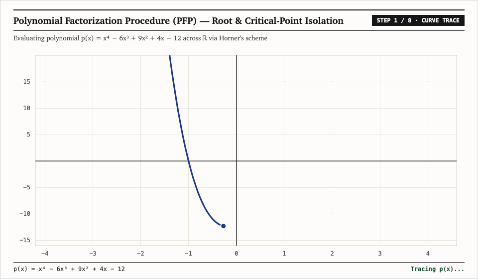

# Polynomial

**Polynomial** is a research project, zero-dependency Python library (`polynomial`), and interactive TypeScript/React numerical laboratory for **univariate polynomial algebra**, **iterative root-finding** (*Newton's Method*, *Secant Method*, *Bisection Method*), and the **Polynomial Factorization Procedure (PFP)**.

- **Interactive Web Companion**: [mk314k.github.io/Polynomial/](https://mk314k.github.io/Polynomial/)
- **Research Paper (PDF & LaTeX)**: [`UI/public/paper.pdf`](UI/public/paper.pdf) &middot; [`research/paper.tex`](research/paper.tex) (*"Iterative Root-Finding Methods and the Polynomial Factorization Procedure"*)



---

## Three Pillars of the Repository

### 1. Mathematical Research (`research/paper.tex`)
Analyzes the theoretical convergence orders, basins of attraction, and failure modes of iterative root-finding algorithms on real polynomials:
- **Cauchy Bound on Root & Critical-Point Magnitudes (Proposition 1 & Corollary 1)**: All real roots and critical points of $p(x) = \sum_{r=0}^n a_r x^r$ lie strictly inside $[-M_p, M_p]$ where $M_p = \max\left\{1, \sum_{r=0}^{n-1} |a_r / a_n|\right\}$.
- **Newton's Method (`Order 2` for simple roots, `Order 1` with rate $1 - 1/k$ for multiplicity $k$)**: Proves existence of guaranteed-convergent monotone basins around every root via inflection-point partitioning (`Algorithm 2`), where $\operatorname{sign}(p(x_0)) = \operatorname{sign}(p''(x_0)) \implies \Psi'_p(x) > 0$.
- **Secant Method (`Order` $\phi = \frac{1+\sqrt{5}}{2} \approx 1.618$)**: Proves superlinear golden-ratio convergence via the Fibonacci error recurrence $g_{n+1} = g_n + g_{n-1}$.
- **Polynomial Factorization Procedure (`PFP`, Algorithm 5)**: Recursively computes critical points $c_1 < \dots < c_k$ ($f'(c_i) = 0$) and inflection points $d_1 < \dots < d_s$ ($f''(d_j) = 0$), detects multiple roots at $f(c_i) = 0$ with exact multiplicity $m_i + 1$, and isolates every simple root across sign-changing monotone intervals $(c_i, c_{i+1})$ using inflection-guided Newton-Bisection.

### 2. Python Library (`polynomial/`)
Installable zero-dependency Python package supporting polynomial arithmetic, Euclidean division (`divmod`, `//`, `%`, `/`), rational functions (`RationalPoly`), analytical derivatives, and root-finding:

```bash
pip install -e .
```

```python
from polynomial import Polynomial, parse

p = parse("x^4 - 6x^3 + 9x^2 + 4x - 12")

# Classical iterative root-finding traces
newton_trace = p.newton(x0=3.6)          # Quadratic convergence -> 3.0
secant_trace = p.secant(2.5, 3.8)        # Golden-ratio convergence -> 3.0
bisect_trace = p.bisection(2.4, 4.0)     # Linear interval halving -> 3.0

# Polynomial Factorization Procedure (PFP)
print(p.pfp_roots())
# [(-1.0, 1), (2.0, 2), (3.0, 1)]

print(p.factorize()["factored"])
# (x + 1)(x - 2)^2(x - 3)
```

### 3. Interactive Factorization & Root-Finding Web Lab (`UI/`)
A 100% client-side TypeScript + React application deployed on GitHub Pages that visualizes:
- $p(x)$, first derivative $p'(x)$ critical-point partition lines, second derivative $p''(x)$ inflection points, and Newton's rational map $\Psi_p(x) = x - \frac{p(x)}{p'(x)}$.
- Side-by-side step-by-step iteration tables for **PFP Factorization**, **Newton's Method**, **Secant Method**, and **Bisection Method** across the paper's benchmark polynomials.

```bash
cd UI
npm install
npm run dev
```

---

## Running Tests

```bash
python3 -m unittest discover -s tests -p "test_*.py" -v
```

## License

Licensed under the [MIT License](LICENSE).
